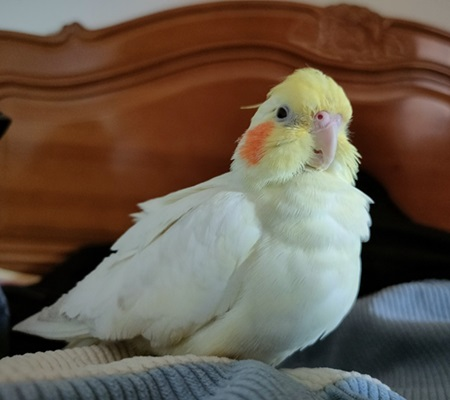
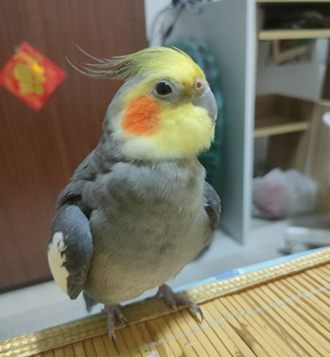

### Hi, I am miyan

I'm a C++ and Python developer.

[Blog](https://blog.miyan.site)

### Open Source

My main open-source contributions are to
[vcpkg](https://github.com/microsoft/vcpkg/pulls?q=is%3Apr+is%3Amerged+author%3Amiyanyan) and
[Zeno](https://github.com/zenustech/zeno/pulls?q=is%3Apr+is%3Amerged+author%3Amiyanyan).

I also contribute fixes and improvements to
[LLVM/MLIR](https://github.com/llvm/llvm-project/pulls?q=is%3Apr+is%3Amerged+author%3Amiyanyan),
[ONNX Runtime](https://github.com/microsoft/onnxruntime/pulls?q=is%3Apr+is%3Amerged+author%3Amiyanyan),
[llama.cpp](https://github.com/ggml-org/llama.cpp/pulls?q=is%3Apr+is%3Amerged+author%3Amiyanyan),
[yalantinglibs](https://github.com/alibaba/yalantinglibs/pulls?q=is%3Apr+is%3Amerged+author%3Amiyanyan),
[spdlog](https://github.com/gabime/spdlog/pulls?q=is%3Apr+is%3Amerged+author%3Amiyanyan),
[zmij](https://github.com/vitaut/zmij/pulls?q=is%3Apr+is%3Amerged+author%3Amiyanyan),
and other projects.

[View all merged PRs →](https://github.com/search?q=is%3Apr+is%3Amerged+author%3Amiyanyan&type=pullrequests)

I have two parrots and I am very happy to share them with you.

I also make toys and everyday tools for them — [explore my parrot projects](https://github.com/miyanyan/miyan-bird-toys).

  
  

### GitHub Stats

